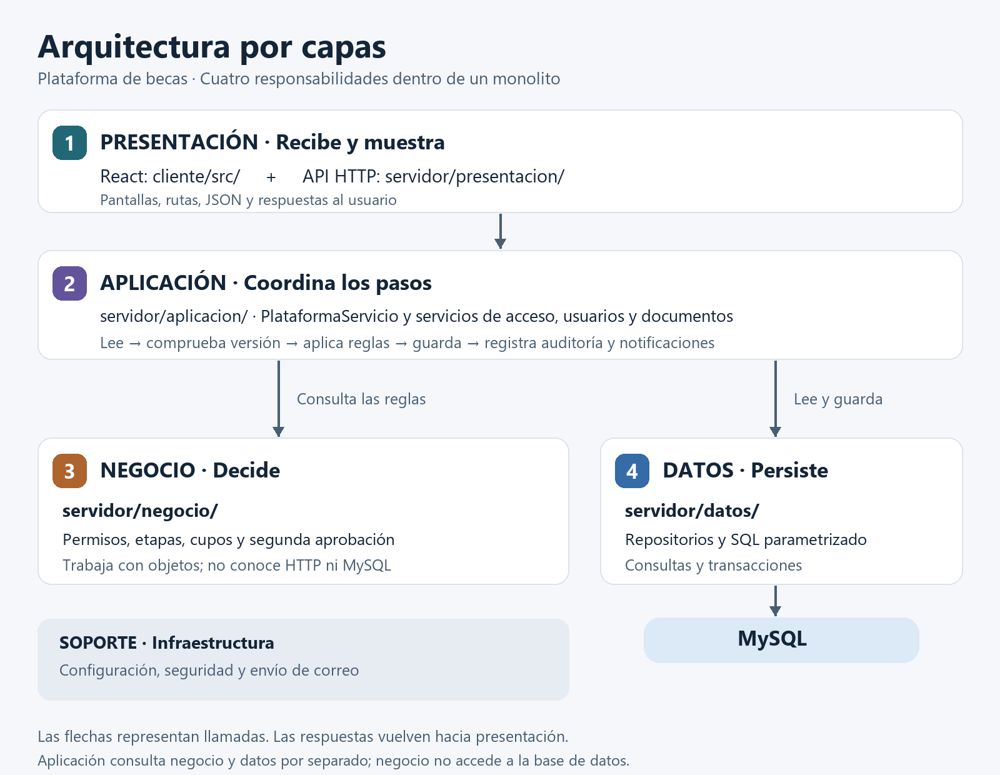
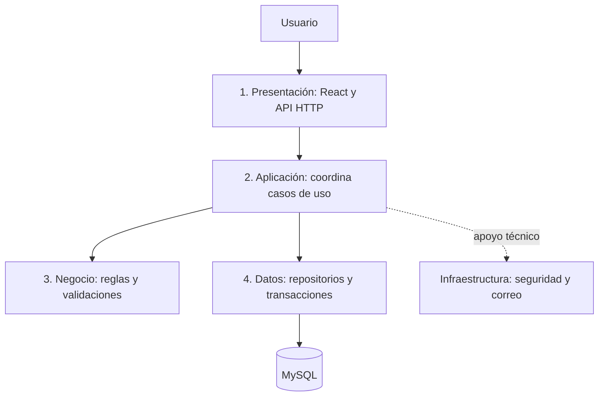

# Arquitectura por capas de la plataforma de becas

La aplicación es un **monolito con cuatro capas lógicas**: presentación, aplicación, negocio y datos. React corre en el navegador; un proceso Node.js publica la API y la interfaz compilada; MySQL conserva la información. Una capa es una responsabilidad del código, no un servidor independiente.

## Esquema





Las flechas representan llamadas. Aplicación consulta datos, ejecuta reglas y solicita guardar el resultado. Negocio recibe objetos JavaScript y no llama a MySQL. No es una cadena rígida que deba atravesar cuatro carpetas consecutivas. Las respuestas vuelven a través de aplicación y presentación.

## Distribución de carpetas

```text
cliente/src/                         PRESENTACIÓN EN EL NAVEGADOR
  paginas/                          Pantallas por rol
  componentes/                      Elementos reutilizables
  api/                              Cliente HTTP y caché del panel
servidor/
  presentacion/                     1. PRESENTACIÓN HTTP
    rutas.js                        Traduce URL, método y cuerpo a una operación
    http.js                         JSON, cookies y respuestas de archivos
    aplicacion.js                   Publica cliente/dist y traduce errores HTTP
  aplicacion/                       2. APLICACIÓN
    plataformaServicio.js           Coordina lectura, reglas, guardado y seguimiento
    autenticacionServicio.js        Coordina registro, login y sesiones
    usuariosServicio.js             Coordina creación y activación de cuentas
    documentosServicio.js           Coordina consulta y carga de documentos
  negocio/                          3. NEGOCIO
    solicitudesReglas.js            Formulario, revisión, reservas y aprobaciones
    becasReglas.js                   Creación de becas, cupos y validación de comités
    entrevistasReglas.js            Publicación de horarios y entrevistas
    documentosReglas.js             Propiedad, edición y formato de documentos
    cuentas.js                      Validación de cuentas y datos públicos
    validaciones.js                 Roles, números, fechas y búsquedas del modelo
  datos/                            4. ACCESO A DATOS
    plataformaRepositorio.js        Modelo relacional, documentos y seguimiento
    usuariosRepositorio.js          Usuarios, sesiones y ciclo de transacciones
    comiteRepositorio.js            Consulta y asignación de comités
  infraestructura/                  SOPORTE TÉCNICO
    configuracion/                  Variables, pool MySQL, certificados y SMTP
    correo/                         Plantillas, transportes y despachador
    seguridad.js                    Hashes de contraseñas y tokens
  compartido/                       Error esperado entre capas
  iniciar.js                        Conecta las implementaciones e inicia el servidor
base-datos/                         Migraciones SQL y catálogo inicial
scripts/                            Operación, migración y demostración
pruebas/                            Pruebas automáticas
legado/                             Referencia histórica, fuera de ejecución activa
```

## Responsabilidad de cada capa

| Capa | Pregunta | Ejemplo | Límite |
| --- | --- | --- | --- |
| Presentación | ¿Cómo interactúa el usuario? | Formulario y POST /solicitudes | Sin SQL ni decisiones de aprobación |
| Aplicación | ¿Qué pasos hay que coordinar? | Leer, comprobar versión, aplicar reglas, guardar y auditar | Sin SQL ni cálculo de segunda aprobación |
| Negocio | ¿Qué permite el proceso? | Más de Q10,000 requiere otro administrador | Sin HTTP, React, repositorios ni infraestructura |
| Datos | ¿Cómo consultamos y guardamos? | SELECT parametrizado, INSERT y commit/rollback | Sin decisiones sobre permisos o etapas |

La validación de interfaz ayuda al usuario; el servidor aplica las reglas autorizadas. El tamaño del cuerpo HTTP y el tipo MIME se verifican en presentación. Las condiciones de propiedad y edición de documentos se aplican desde aplicación usando negocio. Las restricciones relacionales siguen en MySQL y sus migraciones.

## Ejemplo completo: aprobar Q15,000

1. Un administrador pulsa aprobar. El cliente envía `POST /api/plataforma/resultados` con usuario, estado, comentario y versión.
2. `presentacion/rutas.js` identifica `fase4`, obtiene el actor autenticado y llama a `PlataformaServicio.accion()`.
3. Aplicación abre una transacción a través del repositorio. Datos bloquea el control de versión y carga el estado.
4. Aplicación comprueba la versión y vuelve a consultar la cuenta para confirmar que siga activa.
5. `SolicitudesReglas.resultado()` exige revisión aprobada, entrevista realizada y cupos. Al superar Q10,000, establece `pendiente_aprobacion`.
6. Aplicación pide a datos guardar cambio, auditoría, notificación y correo pendiente dentro de la misma transacción.
7. El repositorio confirma. Después el despachador puede enviar el correo. La API devuelve el estado actualizado.
8. La pantalla muestra la segunda aprobación pendiente. Un administrador distinto debe completarla; la regla está en `segundaAprobacion()`.

Si una regla rechaza el cambio, se revierte la transacción. Si falla el transporte de correo, el cambio confirmado permanece y el envío puede reintentarse.

## Cómo se mantienen los límites

- Las rutas reciben servicios construidos; no importan repositorios ni configuración MySQL.
- Los servicios reciben repositorios por constructor: MySQL en producción y memoria en pruebas y demo.
- Negocio recibe datos en memoria y cambia esos objetos; no recibe conexiones ni transacciones.
- El SQL del flujo normal está en datos. Migraciones y diagnósticos son scripts operativos y pueden contener SQL.
- `iniciar.js` es el punto de composición: conoce las capas para conectarlas.
- `pruebas/capas.test.js` detecta imports prohibidos y SQL en presentación, aplicación o negocio. Complementa la revisión humana.

## Cambios realizados

- Carpetas explícitas y reglas distribuidas por responsabilidad.
- Validación de cuentas separada de autenticación y de algoritmos de seguridad.
- Permisos de documentos trasladados desde el repositorio hacia aplicación y negocio.
- Comité convertido a módulos ES y conectado a la misma transacción. Su INSERT usa las columnas reales de `005-comites.sql`.
- Ruta `/becas/:id/comite` con extracción real del identificador.
- `005-comites.sql` incorporado al migrador sin modificar su contenido ni migraciones anteriores.
- Asignación repetida sin otra relación idéntica a través del servicio, protegido por el bloqueo global.
- Pruebas de documentos, comités y límites de capas.

La asignación de comités está disponible por API y en el mapa de operaciones del cliente. No se agregó una pantalla de gestión de comités.

## Límites conservados

Se conservan el modelo de estado completo, la versión global, el bloqueo de `control_plataforma` y la caché de 15 segundos. Esta reorganización mejora claridad y separación; no es una optimización de alta concurrencia. Después pueden incorporarse consultas paginadas, consultas por usuario y versiones por solicitud. El repositorio principal aún reúne varias tablas y seguimiento; se puede dividir si crece.

## Ejecutar y comprobar

```powershell
npm ci
npm test
npm run verificar
npm run build
```

Demo sin MySQL: `npm run demo`; abrir `http://localhost:4173`. Cuentas: `alejandro`, `maria`, `admin`, `admin2`, `superadmin`; contraseña `123`, exclusiva de la demo. Los datos se pierden al detenerla y los correos se guardan como archivos locales.

Para MySQL: copiar `.env.example` a `.env`, completar credenciales y seguir el README. Ejecutar `npm run migrar` antes de iniciar: ahora incluye comités. La integración real, `npm run test:integracion`, exige una base vacía cuyo nombre termine en `_pruebas`.

Consultar también [GUIA-PRESENTACION.md](GUIA-PRESENTACION.md) y [VERIFICACION.md](VERIFICACION.md).
