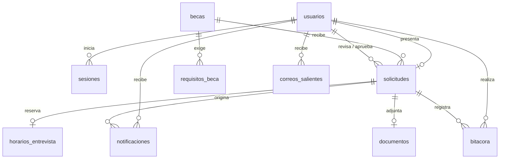

# Base de datos

La base `becas_db` tiene 10 tablas de datos y 2 técnicas. Todas las relaciones usan el `id` numérico, y cada dato vive en un solo lugar.



## Tablas

| Tabla | Contenido | Relaciones |
| --- | --- | --- |
| `usuarios` | Cuentas de aspirantes, administradores y superadministradores; `rol` las distingue | — |
| `sesiones` | Hash del token de cada sesión y su vencimiento | `usuario_id` → `usuarios` (se borran con la cuenta) |
| `becas` | Programas: nombre único, descripción y cupos | — |
| `requisitos_beca` | Un requisito por fila, con su orden | `beca_id` → `becas` (se borran con la beca) |
| `solicitudes` | Las 4 etapas: formulario en columnas (edad, teléfono, promedio, monto…), revisión, entrevista y decisión | `usuario_id`, `beca_id`, `revisado_por`, `aprobado_por`, `segundo_aprobador` |
| `horarios_entrevista` | Fecha, hora y modalidad; `solicitud_id` vacío si está libre | `solicitud_id` → `solicitudes` (único: un horario por solicitud) |
| `documentos` | PDF adjunto de la solicitud | `solicitud_id` → `solicitudes` |
| `notificaciones` | Avisos dentro del panel del aspirante | `usuario_id`, `solicitud_id` |
| `correos_salientes` | Bandeja de salida de correos con reintentos | `usuario_id` → `usuarios` |
| `bitacora` | Toda operación exitosa o rechazada: quién, qué, cuándo, estado anterior y nuevo. Alimenta la Bitácora y la Actividad reciente | `actor_id`, `solicitud_id` |
| `control_plataforma` | Técnica: número de versión para detectar pantallas desactualizadas (HTTP 409) | — |
| `migraciones` | Técnica: migraciones aplicadas y su checksum | — |

## Reglas que la base garantiza por sí sola

- **Unicidad:** usuario, correo y DPI únicos; nombre de beca único; un horario por fecha y hora; una solicitud por aspirante; un horario por solicitud.
- **Formato:** DPI de 13 dígitos, teléfono de 8 dígitos, edad entre 14 y 100, promedio entre 0 y 100, monto mayor que 0 y cupos hasta 100 000.
- **Coherencia:** todo aspirante tiene DPI; no hay entrevista sin revisión aprobada ni decisión sin entrevista realizada.
- **Integridad referencial:** no puede existir una solicitud de un usuario o beca inexistentes, ni un horario, documento o aviso de una solicitud inexistente.

La aplicación también valida todo esto antes de guardar, con mensajes claros; las restricciones de la base son la última línea de defensa si alguien edita los datos desde TablePlus u otro cliente SQL.

## Decisiones de diseño

- **El formulario va en columnas, no en JSON.** Así se puede consultar, por ejemplo, `SELECT * FROM solicitudes WHERE monto > 10000`, y la base valida cada campo. El nombre y el DPI no se copian: se leen de `usuarios`.
- **Los requisitos van en su propia tabla** (primera forma normal) en lugar de una lista JSON.
- **La constancia descargada es una columna** (`constancia_descargada_en`) de la solicitud, no una tabla aparte.
- **Una sola bitácora.** Antes había `actividad_plataforma` (texto libre con la fecha como texto) y `auditoria_solicitudes`. Ahora cada operación deja una fila con `descripcion` (la frase de "Actividad reciente") y los datos de auditoría. `actor_usuario` y `usuario_solicitud` guardan el nombre a propósito, para que el historial no cambie si la cuenta se modifica.
- **Quién revisó y quién aprobó** se guarda como relación con `usuarios` (`revisado_por`, `aprobado_por`, `segundo_aprobador`).
- **Una solicitud por aspirante** es la regla de la convocatoria actual (`uq_solicitudes_usuario`). Para varias convocatorias se agregaría una tabla `convocatorias` y la restricción pasaría a ser única por aspirante y convocatoria.

## Consultas útiles

```sql
-- Solicitudes con aspirante, beca y etapa
SELECT s.id, u.nombre, b.nombre AS beca, s.monto, s.revision, s.entrevista, s.resultado
FROM solicitudes s JOIN usuarios u ON u.id = s.usuario_id JOIN becas b ON b.id = s.beca_id;

-- Cupos ocupados por beca (aceptadas y en segunda aprobación)
SELECT b.nombre, b.cupos, COUNT(s.id) AS ocupados
FROM becas b LEFT JOIN solicitudes s ON s.beca_id = b.id AND s.resultado IN ('aceptada', 'pendiente_aprobacion')
GROUP BY b.id;

-- Correos que no se pudieron enviar
SELECT destinatario, asunto, intentos, ultimo_error FROM correos_salientes WHERE estado = 'fallido';
```
